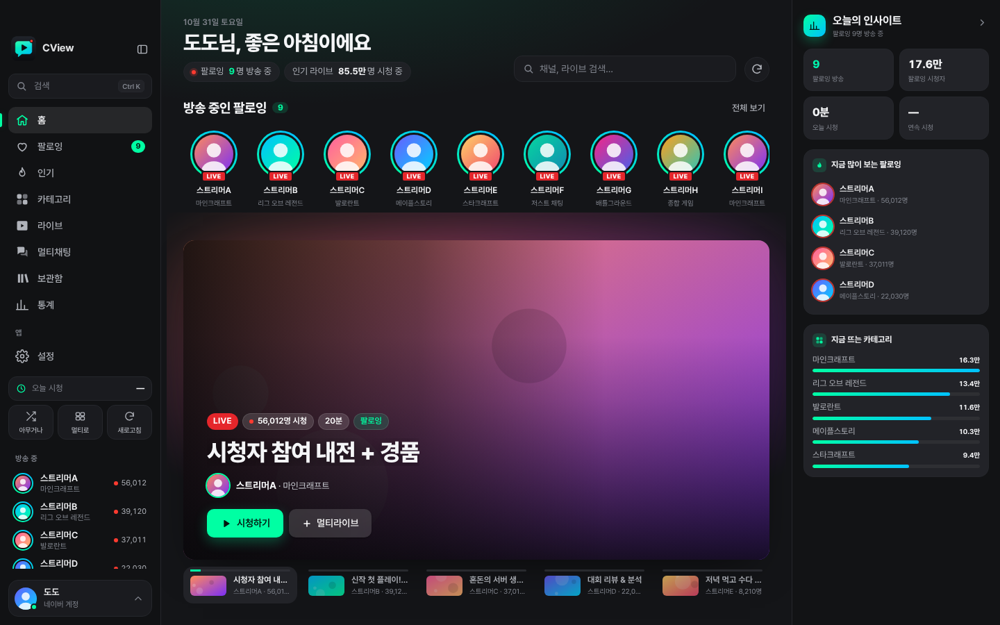
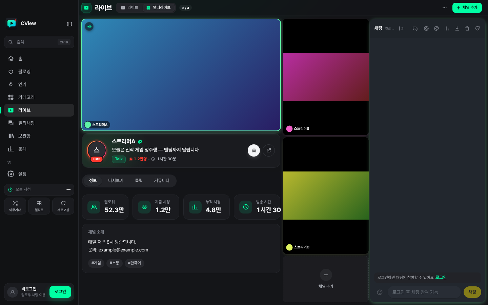
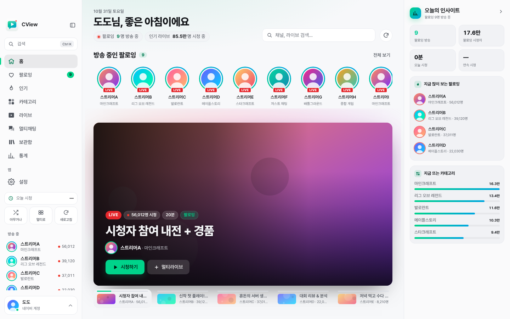

# CView

**치지직(CHZZK) 라이브를 위한 데스크톱 뷰어.** 여러 방송을 한 창에서 동시에 보는 멀티라이브, 저지연 재생, 채팅·후원 알림,
다시보기·클립까지 한 앱에 담았다. macOS(Apple Silicon)와 Windows(x64)를 지원하며, Rust와 [Tauri 2](https://tauri.app/)로 만들었다.

> CView는 개인이 만든 비공식 클라이언트이며 NAVER·치지직과 관련이 없다.



| 멀티라이브 (포커스 배치) | 홈 화면 (라이트) |
|---|---|
|  |  |

<sub>스크린샷은 `tools/ui-regression`의 모의 데이터로 그린 화면이다. 채널 이름·썸네일은 실제 방송이 아니다.</sub>

## 주요 기능

- **홈** — 방송 중인 팔로잉, 스포트라이트, 지금 인기 TOP 10, 최근 시청·이어 보기, 카테고리별 새 라이브 발견, 인기 클립, 오늘의 인사이트
- **둘러보기** — 팔로잉, 인기, 카테고리, 검색(⌘K / Ctrl+K), 썸네일 위에 머무르면 소리 없는 영상 미리보기
- **라이브 시청** — hls.js 기반 저지연 재생(지연 제어·재연결·자동 화질), 채널 정보·다시보기·클립·커뮤니티, 녹화, 선명한 화면(GPU 언샤프 마스크)·밝기·대비·채도 보정
- **멀티라이브** — 여러 방송을 그리드·포커스(위/왼쪽/오른쪽) 배치로 동시 시청, 끌어서 메인 바꾸기, 패인별 소리·화질, 대역폭 자동 배분
- **채팅** — 말풍선형 채팅, 이모티콘, 후원·구독 카드(금액별 색 단계), 영상 위 후원 알림, 차단·금지어·필터, TTS, 멀티채팅, 채팅만 보기
- **보관함** — 팔로우 채널 다시보기, 이어 보기·나중에 보기, 인기 클립, 즐겨찾기·최근 시청, 북마크, VOD·클립 다운로드
- **통계** — 시청 시간·채널/카테고리 순위·시간대·추이, 로컬 데이터 정리와 백업
- **앱** — 네이버 로그인, 다크/라이트 테마, 사용자 단축키, 메뉴 막대·트레이, `cview://` 딥 링크, 창이 가려지면 화질을 낮추는 백그라운드 절약, 앱 안 자동 업데이트

## 내려받기와 설치

최신 버전은 **[cv.dododo.app](https://cv.dododo.app/)** 에서 받는다. 버전별 설치 파일은 `https://cv.dododo.app/releases/<버전>/`에 있고,
변경 사항은 [`CHANGELOG.md`](CHANGELOG.md)에 정리되어 있다.

| 플랫폼 | 파일 | 비고 |
|---|---|---|
| macOS 13 이상, Apple Silicon | `CView_<버전>_arm64.dmg` | Developer ID 서명, Apple 공증 완료 |
| Windows 10/11, x64 | `CView_<버전>_x64-setup.exe` | 사용자 단위 설치. 코드 서명 인증서가 없어 **미서명**이라 SmartScreen 경고가 뜰 수 있다(추가 정보 → 실행) |

v0.1.27부터 앱 안에서 새 버전을 확인하고 받아 검증한 뒤 바꿔 다시 연다(메뉴 또는 설정의 **업데이트 확인**). 그보다 오래된 버전은 한 번만 직접 설치하면 된다.

## 소스에서 빌드하기

필요한 것: 안정판 Rust 툴체인, 그리고 Linux라면 `libgtk-3-dev`, `libwebkit2gtk-4.1-dev`(`libsoup-3.0` 포함) 개발 패키지. 화면(`app-ui/`)은 정적 HTML·CSS·ES 모듈이라 npm이나 번들러가 필요 없다.

저장소 루트(Cargo 작업공간)에서 실행한다.

```sh
cargo run -p cview-app                    # 개발 실행
RUST_LOG=debug cargo run -p cview-app     # 로그 수준 조절
```

Tauri CLI(`cargo install tauri-cli --version "^2"`)가 있으면 `cd crates/cview-app && cargo tauri dev`로도 실행할 수 있다.
앱 데이터(SQLite 스토어 `CView_v2.store`, 설정 미러 `settings.json`)는 OS 앱 데이터 디렉터리의 `app.cview.rust` 아래에 저장된다.

### 검사

PR을 올리기 전에 저장소 루트에서 다음을 통과시킨다.

```sh
cargo fmt --all -- --check
cargo clippy --workspace --all-targets -- -D warnings
cargo test --workspace
for f in app-ui/js/*.js; do node --check "$f"; done
```

화면 회귀 검사는 Playwright로 `app-ui`를 모의 IPC와 함께 띄워 확인한다(예: `node tools/ui-regression/home.mjs`, `CVIEW_UI_SHOTS=<폴더>`를 주면 스크린샷을 남긴다).

## 배포

배포용 릴리스는 메인테이너의 Mac에서 `scripts/release-macos.sh --dmg` 한 명령으로 만든다. 검사, 버전·빌드 번호 증가, macOS 서명·공증,
Windows 설치 파일 교차 빌드, 업데이트 서버 게시, 양쪽 다운로드 검증, 태그 푸시까지 한 번에 진행한다. 자세한 절차는 [`docs/RELEASING.md`](docs/RELEASING.md).

## 프로젝트 구조

```text
crates/
  cview-core          도메인 모델, 오류, 공통 유틸(EWMA·PID·캐시 등)
  cview-networking    치지직 API 클라이언트, 방어적 디코딩
  cview-chat          채팅 프로토콜·파서·WebSocket·재연결·모더레이션
  cview-auth          쿠키·PKCE·OAuth, 자격 증명 저장
  cview-persistence   SQLite(rusqlite) 저장소: 시청 기록·즐겨찾기·설정 등
  cview-player        HLS 매니페스트, 로컬 스트림 프록시, 저지연 제어, 녹화·다운로드
  cview-app-core      화면과 무관한 앱 로직(뷰모델·서비스·내비게이션)
  cview-app           Tauri 2 셸: 창·메뉴·트레이·명령 계층·업데이터
app-ui/               화면(정적 HTML/CSS/JS), player/ 는 hls.js 플레이어 페이지
app-icons/            앱 아이콘 원본과 생성 스크립트
scripts/              배포 스크립트(release-macos.sh, release-with-prs.sh, publish-update.py)
tools/                화면 회귀 검사(ui-regression), 업데이트 서버 도구(windows-update-server)
docs/, perf/          코드 리뷰·배포 문서, 성능 측정 기록
```

## 배경

CView는 원래 Swift 6 / SwiftUI로 만든 macOS 앱(CView v2)이었고, 2026년 10월 Rust 작업공간과 Tauri 2 앱으로 옮겨 Windows까지 지원하게 되었다.
옮긴 과정과 남은 일은 [`PORTING_PLAN.md`](PORTING_PLAN.md), [`PARITY_BACKLOG.md`](PARITY_BACKLOG.md), [`REFINEMENT_BACKLOG.md`](REFINEMENT_BACKLOG.md)에 있다.

## 기여

버그 제보와 제안은 [이슈](https://github.com/dododo-lab/cview-rust/issues)로 받는다. 코드 기여 방법은 [`CONTRIBUTING.md`](CONTRIBUTING.md), 보안 문제 제보는 [`SECURITY.md`](SECURITY.md)를 본다.
