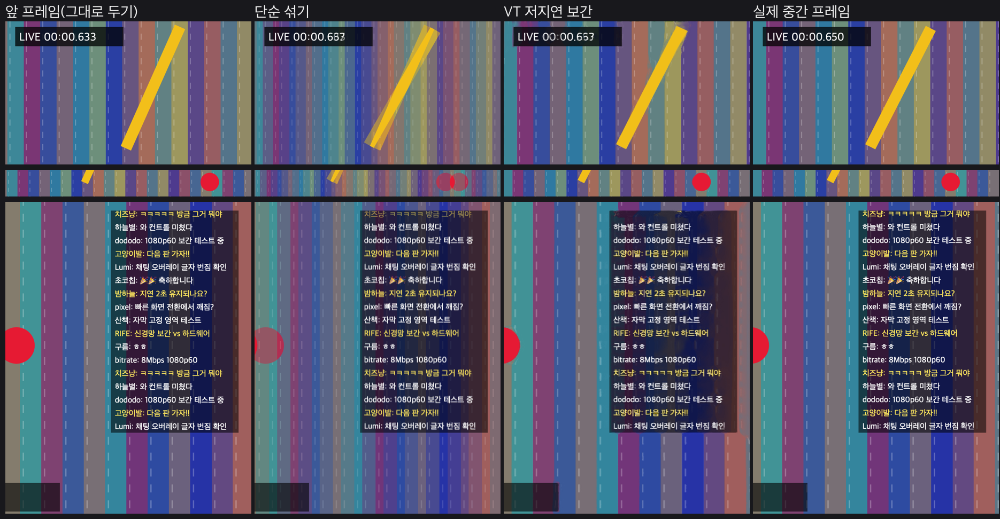

# 뉴럴엔진으로 라이브 영상 실시간 프레임 보간 — 연구·검증 보고서

- 작성: 2026-11-13, 기준 커밋 `b6dbc52`(v0.1.89)
- 측정 기기: MacBook Pro M1 Max(CPU 10코어, GPU 32코어, Neural Engine 16코어), 메모리 64GB, macOS 27.3(26C5035r), Xcode 27.2
- 도구: [`tools/frame-interp-lab`](../../tools/frame-interp-lab/README.md). 앱 코드와 앱 빌드는 바꾸지 않았다.

## 1. 결론

**지금은 앱 기능으로 넣지 않는다.** 실험 도구와 이 보고서만 남긴다.

1. 실시간에 쓸 수 있는 후보는 Apple VideoToolbox의 **`VTLowLatencyFrameInterpolation`(macOS 26 이상)** 하나다. 실제로 Neural Engine(ANE)에서 돌고, GPU 사용률은 변하지 않는다. 화질도 다른 후보보다 확실히 좋다(합성 장면 1080p, 전체 PSNR 29.8dB. 그대로 두기 21.0dB, 단순 섞기 23.9dB).
2. 하지만 이 기기에서 **1080p 보간은 1장에 95ms**가 걸린다. 동시 요청을 늘려도 초당 10.4장이 최대다. 1080p30을 60으로 올리려면 초당 30장, 1080p60을 120Hz ProMotion에 맞추려면 초당 60장이 필요하다. 치지직의 주 화질인 1080p는 M1 Max에서 실시간으로 처리할 수 없다.
3. **720p 이하는 충분히 빠르다.** 720p는 1장에 9~13ms이고, 720p60을 120으로 올려도 연속 처리가 버틴다. ANE 0.7W 안팎, CPU는 1코어의 약 7%가 더 든다. 다만 720p 이하에서는 방송 화면에 박힌 글자(채팅 창·자막·시계)가 그대로 두기보다 나빠진다. 이득은 큰 움직임에 한정된다.
4. 걸림돌이 하나 더 있다. 현재 영상은 WKWebView 안 hls.js(MSE)가 디코드한다. 디코드된 프레임은 WebKit GPU 프로세스 안에 있어 앱(Rust·네이티브)이 꺼낼 수 없다. ANE 보간을 쓰려면 **네이티브 재생 경로를 새로 만들어야 한다**(7장). 웹과 같은 지점(약 2초)에 맞춘 지연 제어(#96~#97)도 그 경로에서 다시 만들어야 한다.
5. WebView 안에서 WebGPU로 하는 방법은 돌아가지만(1080p 10ms), ANE를 쓸 수 없다. 단순한 블록 매칭은 화질이 단순 섞기 수준이고, 글자를 심하게 찢는다. Windows까지 같은 코드로 갈 수 있는 유일한 길이지만, 쓸 만한 화질을 내려면 사실상 광류(optical flow) 보간기를 새로 개발해야 한다.

다시 검토할 조건은 다음과 같다. ① M3·M4 이상 기기에서 1080p 처리가 1장 16ms(60→120) 또는 33ms(30→60) 안에 들어온다. ② 네이티브 재생 경로를 따로 만들 이유(PiP, 전력 등)가 함께 생긴다.

## 2. 현재 재생 구조와 제약

```
치지직 LL-HLS ──▶ cview-player 로컬 프록시(127.0.0.1) ──▶ WKWebView iframe(player.html)
                                                          hls.js 포크 → MSE → <video>
                                                          └ WebKit GPU 프로세스가 디코드·합성
채팅·컨트롤 = 같은 WebView의 HTML (영상 위에 겹침)
```

- `app-ui/player/player.html`의 `<video>`에 hls.js가 MSE로 붙는다. 프레임 확인에는 `requestVideoFrameCallback`을 쓴다.
- `crates/cview-player`는 프록시와 제어(저지연 PID·재연결·대역폭)만 맡는다. 네이티브 디코드·표시 코드는 없다(`lib.rs` 첫 주석: AVPlayer 계열은 옮기지 않음).
- 그래서 보간을 끼울 수 있는 지점은 둘뿐이다.
  - **WebView 안**: `<video>` → WebGPU `importExternalTexture` → 셰이더 보간 → `<canvas>` 표시. WKWebView에서 WebGPU, `importExternalTexture`, WebCodecs `VideoDecoder`가 켜져 있음을 확인했다(`MediaStreamTrackProcessor`는 없음). ANE에는 닿지 않는다.
  - **네이티브**: 앱이 직접 디코드한 프레임(CVPixelBuffer)을 VideoToolbox로 보간한 뒤, WebView 아래 또는 위에 둔 네이티브 레이어에 표시한다.
- 앱의 채팅·자막 UI는 HTML이라 영상 보간에 섞이지 않는다. 영향을 받는 것은 **방송 화면에 박혀 있는** 글자뿐이다(스트리머 화면의 채팅 창, 후원 알림, 점수판, 시계).

## 3. 후보 비교

| 후보 | 하는 일 | ANE | 실시간(M1 Max) | 앱 연결 | Windows |
| --- | --- | --- | --- | --- | --- |
| **VT 저지연 보간** `VTLowLatencyFrameInterpolation` (macOS 26+) | 이전 프레임과 현재 프레임 사이 생성(0.5 지점, 또는 0.25/0.5/0.75). 2배 확대와 함께 쓰는 모드도 있음 | **씀**(측정) | 720p 이하 가능, 1080p 불가 | 네이티브 재생 경로 필요 | 없음 |
| VT 프레임률 변환 `VTFrameRateConversion` (macOS 15.4+) | 고품질 광류 보간(오프라인·편집용) | 미확인 | 1080p 47~60ms, 첫 시작 13초 → 불가 | 같음 | 없음 |
| MetalFX `MTLFXFrameInterpolator` (macOS 26+) | 게임 렌더러용 보간 | — | — | 깊이·움직임 벡터 텍스처가 입력으로 필요(헤더 확인) → 영상에는 광류를 따로 구해 넣어야 해서 부적합 | 없음 |
| Core ML 보간 모델(RIFE 등) | 직접 변환한 신경망 | 가능 | **측정 안 함** | 네이티브 경로 필요 | ONNX/DirectML로 이론상 가능 |
| WebView WebGPU(WGSL) | 블록 매칭·광류 셰이더 | 못 씀 | 단순 블록 매칭 1080p 10ms | 현 구조 안에서 가능 | WebView2 WebGPU로 같은 코드 가능(미확인) |

Core ML RIFE는 측정하지 않았다. 이유는 다음과 같다. VT 저지연 보간이 이미 Apple이 ANE에 맞춘 ML 보간기다(헤더에 "ML model loading" 주의문이 있다). RIFE를 Core ML로 바꾸면 변환·양자화·ANE 호환 연산 정리가 필요하고 이득도 불확실하다. 1080p에서 VT보다 빠르다는 근거를 찾기 전에는 우선순위가 낮다.

## 4. 측정 방법

- **합성 장면**(`bench.m`): 1080p 기준으로 가로 팬 배경 1200px/s, 회전 막대 180°/s, 빠른 공 2400px/s(30fps 입력이면 프레임당 80px), 프레임마다 바뀌는 타이머 글자, 60px/s로 올라가는 반투명 채팅 상자, 고정 자막을 그린다. 정답 프레임을 2배 속도로 만든 뒤 짝수만 입력하고, 홀수 정답과 보간 결과를 휘도 PSNR로 비교한다. 영역별(채팅·자막·빠른 공·타이머)로도 잰다.
- **실제 영상**: Apple 공개 HLS 예제 `img_bipbop_adv_example_fmp4` v9(1920×1080, 60fps)의 앞 24초. 60fps에서 한 장 걸러 입력하고 빠진 장과 비교한다. 치지직 라이브는 쓰지 않았다(로그인·채팅 없음).
- **비교 기준**: 그대로 두기(앞 프레임 반복, 지금 화면이 하는 일), 단순 섞기(두 프레임 평균, CPU 1080p 약 1ms).
- **사용률**: `--loop`으로 입력 속도에 맞춰 40초 돌리는 동안 Vitals(ANE 활동률·전력)와 `ioreg`(GPU Device Utilization)를 보았다. 측정하는 동안 다른 앱 부하가 있었다(시스템 CPU 43%, GPU 35% 안팎). 그래서 GPU·전력 수치는 차이로만 해석한다.
- 처리 시간은 `processWithParameters` 동기 호출의 벽시계 시간이다. BGRA→420v 변환(1080p 약 2.5ms)은 따로 쟀다. 실제 디코더 출력은 이미 420v라 이 변환은 실제 경로에는 없다.

## 5. 결과

### 5.1 VT 저지연 보간 — 크기별 처리 시간(30→60, 합성 장면)

| 크기 | 1장 p50 | p95 | 세션 시작(첫 실행 / 다음) | 전체 PSNR 보간 / 그대로 / 섞기 |
| --- | --- | --- | --- | --- |
| 640×360 | 8.3ms | 9.0ms | 0.1s | 24.9 / 22.6 / 25.3 |
| 960×540 | 13.3ms | 14.5ms | 0.06s | 25.6 / 22.9 / 24.2 |
| 1280×720 | 13.3ms (연속 처리 시 9.3ms) | 14.9ms | 1.1s / 0.03s | 26.1 / 21.4 / 24.0 |
| **1920×1080** | **94.5ms** | 101ms | 3.6s / 0.1s | **29.8** / 21.0 / 23.9 |
| 1440×810, 1600×900, 1664×936, 1760×990 | 실패 | | | `Processor is not initialized`(-19730) |

- 720p 이하에서는 채팅·자막·타이머 영역 PSNR이 그대로 두기보다 낮다(720p: 채팅 18.9 / 17.1, 자막 23.9 / 30.8, 타이머 15.0 / 19.8). 화소가 적을수록 글자 획이 가늘어 보간이 더 쉽게 무너진다. 큰 움직임(빠른 공 34.7 / 22.2)에서만 이득이 확실하다.
- 720p 60→120: 1장 p50 13.4ms, 전체 PSNR 27.4 / 23.8 / 26.2(보간 / 그대로 / 섞기), 빠른 공 38.4 / 24.4 / 26.7.
- 같은 조건을 다시 돌려도 처리 시간은 비슷하게 나왔다(1080p p50 94.9ms). 다만 드물게 크게 튄다. 실제 영상 720p를 두 번째로 돌렸을 때 p50은 11.2ms였지만 p95가 212ms였다. 다른 앱 부하 때문으로 보이지만 원인은 확인하지 않았다. 실제 기능에는 마감을 넘기면 보간을 건너뛰는 장치가 꼭 있어야 한다.
- macOS 27 API(`maximumDimensionForSpatialScaleFactor:1`, `maximumPixelCountForSpatialScaleFactor:1`)로 확인한 상한은 한 변 1920, 화소 수 1920×1080이다. 1080p가 상한이고 1440p·4K는 안 된다.
- 지원 입력 형식은 `420v`(NV12 비디오 범위) 하나다. VideoToolbox H.264 디코더 출력 그대로 넣을 수 있다.
- 720p에서 1080p로 가면 화소는 2.25배인데 시간은 7배가 된다. 모델 또는 실행 경로가 바뀌는 것으로 보인다(아래 ANE 활동률 차이 참고).

### 5.2 1080p를 살리는 방법들

| 방법 | 결과 |
| --- | --- |
| 비동기 동시 요청 1 / 2 / 4개 | 초당 6.0~10.2 / 10.2~10.4 / 10.4장, 요청당 지연 94 / 189 / 378ms → 30장/s 불가 |
| 720p로 줄여 보간한 뒤 1080p로 키움 | 8~15ms(두 번 측정). 전체 PSNR 25.4(그대로 21.1, 섞기 23.9). 하지만 자막 21.7(그대로 30.8), 타이머 15.4(그대로 19.7)로 **글자가 흐려진다**. 진짜 프레임(선명)과 보간 프레임(흐림)이 번갈아 나와 글자가 깜박여 보일 위험 |
| VT 프레임률 변환(normal / quality) | 1080p 47~62ms, 첫 세션 시작 13.6초. quality 모드는 이 쓰임에서 오히려 PSNR이 낮았다(22.8) |

### 5.3 연속 처리(실시간 모사)와 자원

| 조건 | 마감 초과 | 보간이 더한 CPU | ANE | GPU |
| --- | --- | --- | --- | --- |
| 720p, 60→120(마감 16.7ms) | 18%* | 1코어의 약 7% | 활동 46%, 0.73W | 변화 없음 |
| 1080p, 30→60(마감 33ms) | 99.7% | 1코어의 약 45% | 활동 17%, 0.53W | 변화 없음 |

\* 측정기는 프레임마다 CoreGraphics로 장면을 그리고 BGRA→420v 변환도 한다(합쳐 6~8ms). 보간만 보면 p95가 11.3ms라 마감 안이다. 실제 경로(디코더 출력 그대로 보간)라면 초과는 거의 없을 것으로 본다. 다만 실제 앱에서 재지는 않았다.

전력은 Vitals가 보여 주는 ANE 전력만 보았다. 시스템 전체 전력 차이는 다른 앱 부하 때문에 가려 판단하지 않았다(`powermetrics`는 관리자 권한이 필요해 쓰지 않음).

### 5.4 실제 영상(bipbop 1080p60 → 한 장 걸러 30→60)

| 크기 | 알고리즘 | 1장 p50 | PSNR 보간 / 그대로 / 섞기 | 최저(보간) |
| --- | --- | --- | --- | --- |
| 1920×1080 | VT 저지연 | 94.5ms | 35.5 / 31.5 / 36.5 | 25.0 |
| 1280×720 | VT 저지연 | 9.7ms | 32.4 / 31.7 / 36.9 | 26.2 |
| 1920×1080 | VT 프레임률 변환 | 46.7ms | 34.0 / 31.5 / 36.5 | 25.0 |
| 1280×720 | VT 프레임률 변환 | 55.0ms | 36.2 / 31.7 / 36.9 | 26.0 |

bipbop은 화면 대부분이 정지한 시험 화면이다. 그래서 평균 PSNR은 단순 섞기가 가장 높다(움직임이 작으면 평균을 낸 흐림이 PSNR에 유리하다). 이 숫자는 "보간이 영상을 망가뜨리지 않는가"를 보는 용도다. 부드러움의 이득은 움직임이 큰 합성 장면에서 판단한다.

### 5.5 WebView(WKWebView) 안 WebGPU 블록 매칭

WGSL로 만든 양방향 블록 매칭 보간이다. 16×16 블록, 중간 프레임 기준 대칭 탐색 ±R, 움직임 벡터는 쌍선형으로 보간했다. 합성 장면을 단순화한 같은 성격의 장면에서 쟀다.

| 크기 | 탐색 R | GPU 시간 p50 | PSNR 보간 / 그대로 / 섞기 |
| --- | --- | --- | --- |
| 1920×1080 | 48 | 54ms | 19.9 / 20.0 / 23.3 |
| 1920×1080 | 24 | 10ms | 23.8 / 20.0 / 23.3 |
| 1280×720 | 32 | 10ms | 20.7 / 20.2 / 23.3 |

- 시간은 WebKit `performance.now()` 해상도(1ms)와 `onSubmittedWorkDone` 왕복이 섞여 10ms 아래로는 구분되지 않는다.
- 반복 무늬 배경에서 벡터가 엉뚱한 곳을 가리키고, 글자(채팅·타이머)가 크게 찢어진다. 화질은 단순 섞기와 비슷하거나 낮다. 쓸 만한 수준이 되려면 계층(피라미드) 광류, 가림(occlusion) 처리, 신뢰도 기반 섞기가 필요하다. 사실상 보간기를 새로 개발하는 일이다.
- `<video>` → `importExternalTexture` 경로의 프레임당 비용과 `<canvas>` 표시 지연은 재지 않았다(캔버스 → 텍스처 업로드는 1080p 3~4ms).

## 6. 화질 관찰



위 그림은 1080p, 30→60, 21번째 입력 쌍이다. 열은 왼쪽부터 앞 프레임(그대로 두기), 단순 섞기, VT 저지연 보간, 실제 중간 프레임이다.

- **빠른 물체·회전 막대**: VT 보간은 제 위치에 한 개로 그린다(빠른 공 영역 PSNR 36.3dB, 섞기 24.5dB). 섞기는 두 개가 겹쳐 보인다.
- **프레임마다 바뀌는 글자(타이머·점수판)**: 보간이 두 숫자를 섞어 "0.6ǝ3"처럼 깨진다. 이 영역은 섞기나 그대로 두기보다 PSNR이 낮다(18.7 / 20.2 / 19.7). 30fps 원본에서 이 프레임은 16ms 동안 보인다.
- **반투명 채팅 상자(방송 화면에 박힌 것)**: 움직이는 배경 위 정지한 상자의 가장자리가 출렁이고, 맨 위 줄이 사라지는 프레임이 있다. 줄 글자 자체는 대체로 유지된다(채팅 영역 23.2dB, 섞기 20.1dB).
- **고정 자막**: 배경이 흐르는 자리의 고정 글자 주변에 약한 흔들림이 생긴다. 이 영역은 그대로 두기가 가장 낫다(28.4 / 30.7 / 33.1).
- 앱의 채팅 오버레이·자막·컨트롤은 HTML로 영상 위에 그려지므로 이런 깨짐을 겪지 않는다.

## 7. 앱에 넣는다면 — 연결 방법

ANE 보간을 쓰려면 디코드된 프레임을 앱이 쥐어야 한다. 가능한 경로를 비용 순으로 적는다.

1. **AVPlayer + `AVPlayerItemVideoOutput` + VT 보간 + `AVSampleBufferDisplayLayer`**(가장 작음)
   - AVFoundation은 LL-HLS를 기본 지원한다. 로컬 프록시 주소를 그대로 줄 수 있다.
   - 비디오 출력에서 420v 프레임을 받아 보간한다. 진짜·보간 프레임에 2배 촘촘한 타임스탬프를 붙여 표시 레이어에 넣는다. 오디오는 AVPlayer가 그대로 낸다.
   - 표시 레이어는 WebView 아래 네이티브 뷰에 두고, `player.html` 영역을 투명하게 뚫는다. 또는 영상 패인만 네이티브로 둔다.
   - 위험: 치지직 LL-HLS를 AVPlayer가 받아들이는지 확인하지 않았다. 지연 제어(목표 2초, 1.03배 따라잡기, 끊김 뒤 목표 +1초)를 `AVPlayerItem.configuredTimeOffsetFromLive`, `automaticallyPreservesTimeOffsetFromLive`, `rate`로 다시 만들어야 한다. 화질 전환(ABR) 정책도 hls.js와 달라진다.
2. **직접 디코드**: 프록시가 받는 세그먼트를 네이티브로 역다중화해 `VTDecompressionSession`에 넣는다. 오디오는 `AVSampleBufferAudioRenderer`로 낸다. 둘은 `AVSampleBufferRenderSynchronizer`로 맞춘다. hls.js의 지연·ABR 로직은 Rust(`crates/cview-player`의 PID·대역폭 코드)로 가져온다. 통제는 가장 좋지만 일이 가장 크다.
3. **WebView 안 WebGPU**: 구조는 바뀌지 않는다. 하지만 ANE를 못 쓰고 화질을 내려면 보간기를 새로 개발해야 한다(5.5). Windows 겸용이 꼭 필요할 때만 검토한다.

추가 지연은 다음과 같다. 보간 프레임은 "다음" 프레임이 도착해야 만들 수 있다. 그래서 화면은 원본보다 **입력 1프레임 간격 + 보간 시간**만큼 늦어진다. 30→60은 33ms + 10ms ≈ 45ms, 60→120은 17ms + 9ms ≈ 26ms다. 목표 지연 약 2초의 2% 안팎이라 웹과 같은 지점을 맞추는 데는 거의 영향이 없다. 영향을 주는 것은 지연이 아니라 처리량(1080p 불가)이다.

## 8. 구현 단계 계획(조건이 맞을 때)

| 단계 | 내용 | 끝났다고 볼 기준 |
| --- | --- | --- |
| 0 | (이번 작업) 측정 도구·보고서 | 이 문서 |
| 1 | M2·M3·M4 이상 기기에서 `run.sh` 재측정 | 1080p 1장 p95가 30→60은 25ms 이하, 60→120은 12ms 이하인 기기 목록 |
| 2 | 별도 실험 앱: 공개 LL-HLS 테스트 스트림 → AVPlayer → VT 보간 → 표시 레이어 | 끊김 없이 1시간, 마감 초과 1% 미만, 프레임 드롭 측정(`tools/ui-regression` 기준 재사용) |
| 3 | 치지직 LL-HLS를 AVPlayer로 재생할 때 지연을 웹과 비교(공개 방송 시청만, 로그인 없음) | 앱과 웹 중앙값 차이가 #96 수준(±0.2초)인지 |
| 4 | 앱에 기능 플래그 "부드러운 화면(실험)", 기본 꺼짐. 단일 패인, 지원 기기·해상도에서만. 멀티라이브·창이 가려졌을 때·배터리 사용 중에는 끔 | 켜고 끄는 데 재생 끊김 없음, 성능 회귀 검사 통과 |

위험:

- **기기 편차**: 1080p 처리 시간이 기기마다 크게 다를 수 있다. 지원 판별은 `isSupported`만으로 부족하고, 실행 중 시간을 재서 넘치면 스스로 끄는 장치가 필요하다.
- **지연·안정성 회귀**: hls.js 포크에 맞춰 둔 지연·끊김 대응(#96, #97)을 새 경로에서 다시 만들어야 한다.
- **화질**: 바뀌는 글자, 장면 전환, 반투명 오버레이에서 깨짐이 생긴다. 장면 전환은 입력 차이가 크면 보간을 건너뛰는 규칙으로 막아야 한다. 이번에는 측정하지 않았다.
- **멀티라이브**: 패인마다 ANE 세션이 필요하다. 720p 패인 2개만 돌려도 ANE 시간이 2배가 되므로, 주 패인 하나에만 허용한다.
- **Windows**: 같은 OS 기능이 없다. NVIDIA Optical Flow SDK의 FRUC(RTX 계열)나 ONNX Runtime/DirectML용 RIFE를 따로 붙여야 하고 기기가 한정된다. 확인하지 않았다.
- **최소 OS**: 앱은 macOS 13 이상이고, 이 기능은 macOS 26 이상에서만 켤 수 있다.

## 9. 검증하지 못한 것

- M1 Max 외 기기(M2·M3·M4, 특히 ANE가 더 빠른 세대)의 처리 시간. 결론이 바뀔 수 있는 가장 큰 변수다.
- 실제 치지직 라이브 영상, 실제 디코더 출력(H.264 → 420v)을 그대로 넣었을 때의 시간. 이번에는 BGRA에서 변환해 넣었다.
- 화면에 실제로 표시했을 때의 체감 부드러움, 프레임 페이싱, ProMotion 120Hz 동작. 표시 경로를 만들지 않았다.
- 시스템 전체 전력. ANE 전력만 보았고 다른 앱 부하가 있었다.
- 장면 전환·컷에서의 깨짐, 장시간(1시간 이상) 연속 처리, 발열에 따른 성능 저하.
- AVPlayer가 치지직 LL-HLS를 재생할 수 있는지와 그때의 지연.
- Core ML RIFE의 ANE 성능, Windows 대안(NVIDIA FRUC, DirectML, WebView2 WebGPU) 성능.
- WebGPU `<video>` → `importExternalTexture` → `<canvas>` 표시 경로의 비용.

## 10. 재현

```sh
curl -r 0-23454228 -o /tmp/bipbop.mp4 \
  https://devstreaming-cdn.apple.com/videos/streaming/examples/img_bipbop_adv_example_fmp4/v9/main.mp4
tools/frame-interp-lab/run.sh /tmp/bipbop.mp4
```

ANE·GPU 사용률은 다른 터미널에서 `bench --loop 40 ...`을 돌리는 동안 Activity Monitor·Vitals·`ioreg -r -d 1 -c IOAccelerator`로 본다.
