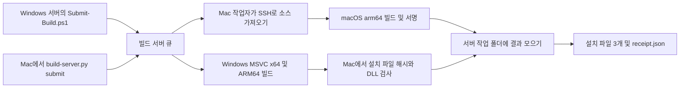

# 빌드 서버와 Mac으로 세 플랫폼 빌드

빌드 서버에 올린 **같은 소스 스냅샷**으로 Windows x64·ARM64 설치 파일과 macOS Apple Silicon DMG를 만든다.
정식 운영 서버는 [Ubuntu](#ubuntu에서-windows-교차-빌드)다. macOS는 Apple SDK와 서명 인증서가 있는 Mac에서 만든다.
Mac의 작업자가 서버 큐를 가져오는 구조여서 Mac에 SSH 수신 서비스를 열 필요가 없다.



아래의 `submit` / `Submit-Build.ps1` 경로는 **개발·검증용 빌드**다. 버전을 올리거나 업데이트 서버·GitHub에 게시하지 않는다. Mac 앱과 DMG에는
Developer ID 서명을 적용하지만 Apple 공증은 하지 않는다. Windows 설치 파일은 미서명이며 SmartScreen 경고가 뜰 수 있다.
배포용 릴리스는 기존 `scripts/release-macos.sh --dmg` / `scripts/release-with-prs.sh` 경로를 사용한다.

## 정식 릴리스의 Windows 빌드

정식 릴리스 명령은 그대로 `scripts/release-macos.sh --dmg`다. 버전 증가 전에 `windows-preflight`로
전용 SSH 접속·호스트·`windows-release-v1` 기능·서버 도구·Mac의 `7zz`·`llvm-readobj`를 점검한다.
버전을 올린 직후 아래 작업을 백그라운드로 시작해 macOS 빌드·공증과 겹친다.

```sh
python3 scripts/build-server.py release-windows --source "$PWD" --version <릴리스-버전> --output dist
```

이 명령은 **Windows 전용 작업**을 제출한다. Mac 자동 작업자는 이 작업을 가져가지 않으므로 macOS를 중복 빌드하지 않는다.
서버는 같은 소스 ZIP으로 MSVC x64·ARM64를 빌드하고, Mac은 두 설치 파일을 받아 해시·PE 아키텍처·DLL 의존성을 검사한다.
두 파일 모두 검사에 통과해야 `dist/`에 내보내고 `CView_<버전>_windows-build.json`을 남긴다.
이 기록은 Windows 빌드 완료 기록이며 릴리스 게시 완료 기록(`*_publish-receipt.json`)은 정식 스크립트가 이후에 따로 만든다.
`release-windows` 자체는 버전을 올리거나 macOS 공증·게시·Git 푸시를 하지 않는다.

Mac 측 다운로드·검사만 중단됐다면 같은 소스를 받은 작업 ID로 정식 배포를 재개할 수 있다.
스크립트가 버전을 다시 맞춘 뒤 서버의 소스 파일을 현재 체크아웃과 대조하고 Windows 검증을 재개한다.

```sh
CVIEW_WINDOWS_RELEASE_JOB=<작업-ID> scripts/release-with-prs.sh
```

Windows 단계만 재개할 때는 `release-windows --job <작업-ID>`와 함께 같은 버전의 소스 경로를 `--source`로 전달한다.

Windows 빌드가 실패하면 원인을 수정하고 새 작업을 제출한다. Mac의 대기를 중단해도 서버 작업과 원본·로그는 보존된다.
컴파일 시 `CVIEW_UPDATE_URL`을 지정했다면 그 공개 HTTPS 주소만 명시적으로 전달한다.
Apple 공증 자격·서명 키·기타 환경 변수는 서버에 전달하지 않는다. 미지정 시 서버 프로세스의 기존 URL 설정도 사용하지 않는다.
Windows 전용 작업에는 Mac 자동 작업자 실행이 필요하지 않으며 정식 릴리스 프로세스가 직접 기다리고 검증한다.

## Windows 서버에서의 세 갈래 동시 빌드

Windows 서버를 사용할 때는 `build_runner.py`가 `Build-Windows.ps1`을 세 갈래(`-Lane check|x64|arm64`)로 동시에 실행한다.
각 갈래는 다른 `CARGO_TARGET_DIR`(`target-check`·`target`·`target-arm64`)을 써서 cargo 잠금에 막히지 않는다.
한 갈래가 실패하면 나머지 갈래는 프로세스 트리째 멈춘다. 갈래 로그는 `windows.log`에 차례대로 붙는다. 마지막 `Lanes:` 줄에 갈래별 소요 시간이 남는다.
`target-check`·`target-arm64`는 바꾼 뒤 첫 빌드에서 한 번 처음부터 컴파일한다.
v0.1.110 기준(차례 실행) 서버 작업은 약 23분이었다. 그중 x64·ARM64 릴리스 빌드가 각각 약 9분이었다.
Mac 쪽(`release-macos.sh`)은 버전을 올린 직후 서버 작업을 시작하고, 단계마다 시각과 경과 시간을 찍는다.

## Windows 서버 최초 설치

관리자 Windows PowerShell에서 이 폴더의 파일을 함께 내려받은 후 실행한다.
계정·주소·키는 공개 저장소에 기록하지 않는다. 공개 키만 전달하고 개인 키를 서버에 복사하지 않는다.

```powershell
powershell -NoProfile -ExecutionPolicy Bypass -File .\Install-BuildServer.ps1 `
  -ClientPublicKey 'ssh-ed25519 <Mac의 빌드 전용 공개 키> <주석>' `
  -ClientAddress '<Mac의 Tailscale IPv4>'
```

설치 내용:

- `C:\CViewBuild\` 아래 도구, 전용 Python 3.13.12 런타임, 작업 큐, 빌드 캐시, 로그를 만든다.
- Python ZIP SHA-256 및 Python Software Foundation 서명을 검사한다.
- MSVC x64·ARM64 도구가 없으면 공식 Visual Studio 2022 Build Tools를 설치한다. 이미 갖춘 Visual Studio는 재사용한다.
- Rust stable, rustfmt, clippy, `x86_64-pc-windows-msvc`, `aarch64-pc-windows-msvc`, Tauri CLI 2.12.3을 설치한다.
- 기존 OpenSSH 관리자 공개 키 파일에 빌드 전용 키 한 줄을 추가한다. 고정 빌드 명령, 출발지 주소 제한, `restrict` 옵션을 적용한다.
- 기존 SSH 수신 주소·방화벽·업데이트 게시 키를 변경하지 않는다. 기존 Tailscale SSH 접속이 먼저 작동해야 한다.

설치 로그는 `C:\CViewBuild\setup.log`다. 다운로드나 설치가 실패하면 같은 명령으로 다시 실행할 수 있다.
Visual Studio가 재부팅을 요청하면 진행 중인 작업을 확인한 뒤 재부팅하고 사전 점검을 다시 한다.

## Ubuntu에서 Windows 교차 빌드

Ubuntu 빌드 서버는 CView의 MSVC x64·ARM64 타깃과 정적 CRT를 유지하고, LLVM과 NSIS로 설치 파일을 만든다.
Rust 워크스페이스의 포맷과 x64 Clippy, ARM64 앱 Clippy를 검사한다. 서버에 할당된 메모리 안에서 동작하도록
한 번에 한 갈래씩 실행하며 Cargo는 갈래당 컴파일 작업을 3개까지 실행한다.

서버에 Rustup과 C 빌드 도구, LLVM·Clang·LLD·NSIS를 설치한다. Tauri CLI 2.12의 Linux 호스트
트레이 라이브러리 검사에는 `pkg-config`와 `libayatana-appindicator3-dev`가 필요하다.
Microsoft 빌드 도구 사용 조건을 확인한 뒤
다운로드한 `cargo-xwin`과 기존 Windows 서버와 같은 버전의 `cargo-tauri` 실행 파일의 SHA-256을 확인한다.
관리자 계정에서 이 폴더의 Python 파일과 두 셸 스크립트를 함께 배치한 뒤 설치한다.

```sh
sudo bash Install-BuildServer.sh /path/to/build-key.pub <Mac-Tailscale-IP> /path/to/cargo-xwin /path/to/cargo-tauri
```

작업과 캐시는 `/srv/cview-build`의 전용 계정에 보관한다. SSH의 고정 명령과 공개 키는 root가 관리한다.
Mac의 `~/.config/cview-build/server.json`에 기존 SSH 설정과 함께
`"windows_validation": {"vm": "<Parallels VM 이름>", "host": "<Mac 사설 IPv4>"}`를 지정한다.
`windows-preflight`는 Ubuntu 도구, Mac의 설치 파일 검사 도구, 로그인한 Windows ARM64 데스크톱과
게스트에서 Mac으로의 연결을 확인한다.

정식 배포는 기존 `scripts/release-macos.sh --dmg`를 사용한다. Ubuntu에서 두 NSIS 설치 파일과 같은
스냅샷의 Windows x64 단위·통합 테스트 실행 파일을 빌드한다. Mac은 설치 파일의 해시·PE 아키텍처·DLL을
검사한 뒤 Parallels에서 x64 테스트를 실행하고 x64와 ARM64 설치·WebView2 시작을 확인한다.
x64 코드는 Windows 11 ARM64의 x64 에뮬레이션에서 실행된다. 서버는 검증 기록의 테스트 아카이브와
두 설치 파일 해시가 해당 작업의 산출물과 일치할 때만 릴리스 빌드 기록을 만든다.

Windows의 분리된 계정에서 설치·시작을 검사하려면 x64·ARM64 설치 파일과 `Test-WindowsInstallers.ps1`을
전용 작업 폴더에 둔다. 스크립트에 그 폴더를 `-Directory`로 넘기고 관리자 권한으로 `-Action Prepare`,
로그인한 Windows 데스크톱의 사용자 세션에서 `-Action Launch`, 관리자 권한으로 `-Action Cleanup`을 실행한다.
검사는 설치된 실행 파일의 PE 아키텍처와 WebView2 시작 여부를 확인하고 설치 파일의 SHA-256을 기록한다.
ARM64 Windows에서 x64 테스트를 실행하면 Windows의 x64 에뮬레이션을 사용한다.

Parallels의 Windows 데스크톱에 로그인돼 있으면 Mac에서도 이 검사를 실행할 수 있다.
이때 `--host`는 게스트에서 접근할 수 있는 Mac의 사설 IPv4 주소다.

```sh
python3 tools/build-server/test_parallels.py --vm '<VM 이름>' --host '<Mac 사설 IPv4>' \
  /path/to/CView_<버전>_x64-setup.exe /path/to/CView_<버전>_arm64-setup.exe
```

## Mac 설정

기존 게시용 키와 별개인 Ed25519 키를 만들고 개인 키 권한을 `0600`으로 둔다.
서버에서 확인한 SSH 호스트 키를 `known_hosts`에 고정한다. `StrictHostKeyChecking`을 끄지 않는다.

`~/.config/cview-build/server.json` 예시(실제 접속 정보는 저장소 밖에만 저장):

```json
{
  "ssh_target": "<관리자 계정>@<서버 Tailscale 주소>",
  "server_name": "<서버 hostname>",
  "ssh_key": "/Users/<사용자>/.config/cview-build/id_ed25519",
  "known_hosts": "/Users/<사용자>/.config/cview-build/known_hosts",
  "tailscale_nc": "/usr/local/bin/tailscale",
  "worker": "<Mac마다 고유한 UUID 32자리 hex>",
  "work_dir": "/Users/<사용자>/.config/cview-build/work",
  "target_dir": "/<빌드 디스크>/cview-build-target",
  "readobj": "/<llvm-mingw 설치 폴더>/bin/llvm-readobj"
}
```

Mac에는 Rust, Tauri CLI, Xcode Command Line Tools, Node.js, `7zz`, `llvm-readobj`, 프로젝트의 Developer ID 인증서가 필요하다.
`target_dir` 상위 폴더와 빌드 디스크가 있어야 한다. 공식 배포용 캐시와 별도 폴더를 사용한다.
전용 Python 클라이언트는 추가 pip 패키지를 요구하지 않는다.

`tailscale_nc`를 지정하면 이 서버의 SSH만 `tailscale nc`를 통해 연결한다. 다른 VPN 등으로 Mac의
Tailscale IP 경로가 바뀌어도 Tailscale 자체 연결을 사용할 수 있다. SSH 전용 키·호스트 키 고정은 그대로 적용한다.
일반 SSH 경로를 쓰려면 이 항목을 생략한다.

```sh
python3 scripts/build-server.py preflight
python3 scripts/build-server.py windows-preflight
python3 scripts/build-server.py install-worker
```

`install-worker` 명령은 클라이언트와 검사 도구를 `~/.config/cview-build/bin/`으로 복사하고,
로그인 사용자의 LaunchAgent `app.cview.build-worker`를 등록한다. Mac 로그인 후 15초 간격으로 새 작업을 확인한다.
Mac은 켜져 있고 Tailscale에 연결되어 있어야 한다. 실행 중에는 `caffeinate -i`로 유휴 잠자기를 막는다.
로그인 키체인이 잠겨 있으면 서명 단계가 실패할 수 있다.

자동 실행 없이 터미널에서 작업하려면 다음을 사용한다.

```sh
python3 scripts/build-server.py worker
# 한 작업만 확인·처리
python3 scripts/build-server.py worker --once
```

## 소스를 서버에 올리고 빌드하기

서버의 `C:\CViewBuild\source\` 같은 폴더에 전체 프로젝트 소스를 올리거나 변경된 파일을 덮어쓴다.
삭제한 파일은 서버 소스 폴더에서도 삭제한다. 빌드 중인 작업은 업로드 후 변경한 소스의 영향을 받지 않는다.

```powershell
powershell -NoProfile -ExecutionPolicy Bypass `
  -File C:\CViewBuild\tools\Submit-Build.ps1 `
  -SourcePath C:\CViewBuild\source -Wait
```

스크립트는 업로드된 폴더의 `Cargo.toml`, `Cargo.lock`, `crates/`, `app-ui/`,
Rust 업데이트 검증 테스트가 참조하는 `tools/windows-update-server/tests/signed_feed_vector.json`을 새 ZIP에 담고
Windows 빌드를 시작한다. Mac 작업자는 같은 ZIP의 SHA-256을 확인한 뒤 macOS를 빌드한다.
`target/`, `gen/`, `node_modules/`, `.git/`, `.cargo/`와 개인 키·`.env` 파일은 빌드 입력이 될 수 없다.
빌드 입력 폴더 안에서 비밀 파일이나 심볼릭 링크를 발견하면 업로드를 거부한다.
Mac 전용 `.cargo/config.toml`은 서버에 보내지 않으며 각 작업자의 `CARGO_TARGET_DIR`을 사용한다.

Mac의 현재 작업 폴더에서 바로 업로드할 수도 있다. 커밋 여부와 관계없이 현재 빌드 입력을 스냅샷으로 만든다.

```sh
python3 scripts/build-server.py submit --wait
# 다른 폴더
python3 scripts/build-server.py submit --source /절대/경로/소스 --wait
```

`--wait`만 생략하면 작업 ID를 표시하고 바로 끝난다. Windows에서 제출했든 Mac에서 제출했든 Mac 작업자가 실행 중이어야 한다.
코드 업로드에는 관리자 계정의 빌드 전용 키가 필요하다. **업로드한 Rust build.rs 등은 양쪽 컴퓨터에서 실행된다.**
이 큐는 신뢰하는 메인테이너 전용이며 외부 PR·익명 업로드를 자동 실행하는 보안 샌드박스가 아니다.

## 결과와 검증

서버 `C:\CViewBuild\jobs\<작업 ID>\`:

```text
source.zip           두 운영체제가 함께 쓰는 원본
job.json             버전, 소스 SHA-256, 생성 시각
windows.log          Windows 검사·컴파일·패키징 로그
windows.json         Windows 작업 상태와 설치 파일 해시
macos.json           Mac 작업 상태와 DMG 해시
artifacts/
  CView_<버전>_x64-setup.exe
  CView_<버전>_arm64-setup.exe
  CView_<버전>_arm64.dmg
receipt.json         세 파일의 빌드·전송·의존성 검사를 모두 마친 기록
```

Mac에도 `work_dir/<작업 ID>/artifacts/`와 `receipt.json`, `macos.log`가 남는다.
Mac 작업자 자체 로그는 `~/.config/cview-build/logs/worker*.log`에 남는다.
양쪽 fmt·clippy·Rust 테스트, Mac의 JavaScript 구문 검사, Windows 바이너리 PE 아키텍처 검사,
다운로드 SHA-256, Mac에서 NSIS를 풀어 실행 파일·DLL 의존성 검사를 통과해야 최종 성공이 된다.
파일 세 개 중 하나라도 실패하면 완료로 처리하지 않는다. 설치와 실제 앱 실행·재생 검증은 별도다.

```sh
python3 scripts/build-server.py status
python3 scripts/build-server.py status <작업-ID>
python3 scripts/build-server.py log <작업-ID>
python3 scripts/build-server.py setup-log
```

Mac 작업자만 중단됐다면 동일한 `worker` ID로 다시 실행하면 현재 작업을 이어간다.
Windows 서버 재부팅·강제 종료로 Windows 빌드가 중단됐다면 새 작업을 제출한다. 이전 작업은 조사용으로 보존한다.
빌드·검사 실패는 원인을 수정한 뒤 새 작업으로 제출한다. 다른 소스나 다른 산출물로 기존 작업을 덮어쓰지 않는다.
작업 폴더·캐시는 자동 삭제하지 않으므로 보관 기간에 따라 관리자가 정리한다.

## 코드 변경 후 검사

```sh
python3 -B -m unittest discover -s tools/build-server/tests -v
python3 -B -m unittest discover -s tools/windows-update-server/tests -v
zsh -n scripts/release-macos.sh
zsh -n scripts/release-with-prs.sh
```

도구 코드 자체를 바꿨으면 서버 관리자에게 `tools/build-server/`를 다시 전달해 설치 스크립트를 재실행하고,
Mac에서 `install-worker`를 다시 실행한다. 빌드 중에는 도구를 교체하지 않는다.

공식 문서: [Tauri Windows 및 ARM64 빌드](https://v2.tauri.app/distribute/windows-installer/),
[Visual Studio Build Tools 구성 요소](https://learn.microsoft.com/en-us/visualstudio/install/workload-component-id-vs-build-tools?view=vs-2022&preserve-view=true),
[Windows OpenSSH 키 관리](https://learn.microsoft.com/en-us/windows-server/administration/openssh/openssh_keymanagement).
